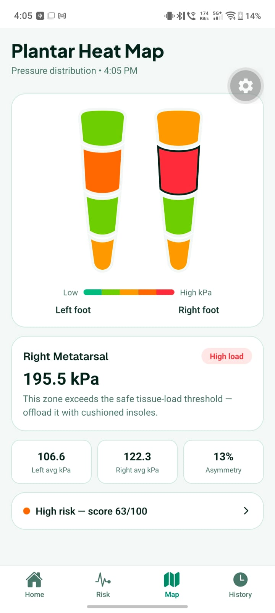
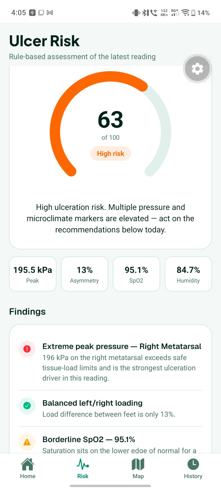
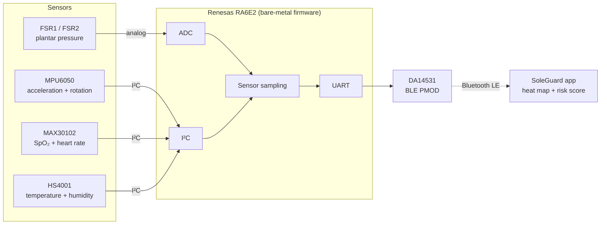

# SoleGuard

**A smart-insole system that warns people with diabetes about foot-ulcer risk before an ulcer forms.**

SoleGuard measures plantar pressure, in-shoe temperature and humidity, blood-oxygen saturation (SpO₂) and foot motion. A **Renesas RA6E2** microcontroller running **bare-metal firmware** reads the sensors and sends the data over **Bluetooth Low Energy (BLE)** to the SoleGuard mobile app, which shows a plantar pressure heat map and an ulcer-risk score with plain-language findings.

> [!WARNING]
> SoleGuard is a student research prototype, not a certified medical device. Its risk score is a screening aid, not a diagnosis.

## App output

| Plantar heat map | Ulcer risk |
|:---:|:---:|
|  |  |

**Plantar heat map.** Pressure in four zones per foot, from toes to heel, colour-coded from low to high kPa. The most loaded zone is called out with a recommendation: in this reading the **right metatarsal at 195.5 kPa** is above the app's safe tissue-load threshold, so the app suggests offloading it with a cushioned insole. Below it are the left and right average pressures (106.6 and 122.3 kPa) and the left/right asymmetry (13%).

**Ulcer risk.** A rule-based score from 0 to 100, here **63 (High risk)**, shown with the readings behind it: peak pressure 195.5 kPa, asymmetry 13%, SpO₂ 95.1% and in-shoe humidity 84.7%. Each finding is explained in plain language. In this reading the right-metatarsal pressure peak is the main driver, loading between the two feet is balanced, and SpO₂ sits at the lower edge of normal.

## Problem statement

### Why diabetic foot ulcers matter

- **Scale in India:** diabetes prevalence is 11.4%, about **101 million people**, and another 15.3%, about **136 million people**, have prediabetes ([ICMR-INDIAB, 2023](#references)).
- **Lifetime risk:** about **one in three people with diabetes develops a foot ulcer**. Roughly half of these ulcers become infected, and about one in five of those infections ends in amputation of part or all of the foot ([JAMA, 2023](#references)).
- **Recurrence:** healing is not the end. Ulcers come back in about **40% of patients within one year and 65% within five years** ([JAMA, 2023](#references)).

### Why they happen

Diabetes damages the nerves in the feet (**peripheral neuropathy**). The person loses protective sensation, so nothing hurts when:

1. **Pressure stays high under bony areas.** The metatarsal heads and the heel take load with every step, and the tissue slowly breaks down.
2. **The inside of the shoe stays warm and damp.** Moist skin softens (macerates), cracks and lets infection in.
3. **Blood supply to the foot is poor.** Damaged tissue heals slowly, or not at all.

By the time an ulcer is visible, the damage has already been done ([Armstrong et al., 2017](#references)).

### The gap

- Feet are checked **only at occasional clinic visits**, but the pressure that causes ulcers builds up **during everyday walking and standing, between those visits**.
- Patients **cannot feel** the warning signs, because neuropathy has switched off their alarm.
- Acting on pressure works, but only when it happens in daily life:
  - Pressure-relieving custom footwear helped only the patients who actually wore it. Among those who wore it for at least 80% of their steps, ulcer recurrence fell from 47.8% to 25.7%, a 46% relative reduction ([Bus et al., 2013](#references)).
  - Patients using a smart insole that alerted them through a smartwatch whenever it detected abnormal pressure had **71% fewer ulcers** than the control group, and 86% fewer among those who wore it at least 4.5 hours a day ([Abbott et al., 2019](#references)).

### Our problem statement

> People with diabetes cannot feel the plantar pressure peaks, unhealthy in-shoe conditions and poor perfusion that lead to foot ulcers, and today these risk factors are checked only during infrequent clinic visits.
>
> **SoleGuard's goal is a low-cost, wearable system that measures these risk factors continuously during daily life and turns them into an early, easy-to-understand warning, so the patient can offload the foot before an ulcer forms.**

## Our solution

SoleGuard puts the missing alarm back. The sensors map onto the risk factors above:

| Risk factor | What SoleGuard measures | Sensor |
|---|---|---|
| High plantar pressure | Pressure under the foot (kPa), the most loaded zone, left/right asymmetry | 2 × FSR (force-sensitive resistor) |
| Warm, damp in-shoe microclimate | Temperature and relative humidity inside the shoe | Renesas HS4001 |
| Poor perfusion | Blood-oxygen saturation (SpO₂) and heart rate | MAX30102 |
| Activity context | Foot motion (3-axis acceleration and rotation) | MPU6050 |

How it works, end to end:

1. The **RA6E2** samples every sensor in bare-metal C firmware (no RTOS), built with Renesas e² studio and the Flexible Software Package (FSP).
2. The readings are sent over **BLE** through a Renesas **DA14531** module.
3. The **SoleGuard app** draws the plantar heat map, computes the ulcer-risk score, explains what is driving it and recommends what to do.

## System architecture

The firmware reads the two FSRs through the ADC and the three digital sensors over I²C, then hands the data to the DA14531 module, which carries it to the phone over Bluetooth Low Energy.

## Hardware

| Part | Role | Interface |
|---|---|---|
| Renesas RA6E2 MCU board | Main controller running the bare-metal firmware | — |
| 2 × FSR (FSR1, FSR2) | Plantar pressure | ADC |
| MPU6050 | 3-axis accelerometer + 3-axis gyroscope | I²C |
| MAX30102 | Pulse oximeter and heart-rate sensor | I²C |
| Renesas HS4001 | Relative humidity and temperature | I²C |
| Renesas DA14531 PMOD | Bluetooth Low Energy link to the app | UART |

The MAX30102 and HS4001 connect to the I²C bus on the board's Arduino-header pins D14/D15.

## Firmware

The firmware is bare-metal C for the RA6E2, built in Renesas **e² studio** with the **Flexible Software Package (FSP)**. The main FSP modules in the project's stack configuration:

| FSP module | Role in SoleGuard |
|---|---|
| I²C Master on SCI (`r_sci_i2c`), instance `g_i2c0` | I²C bus for the sensors |
| GTL BLE Abstraction (`rm_ble_abs_gtl`) | Bluetooth Low Energy through the DA14531 |
| DA14531 GTL Driver Layer and BLE GTL Transport on UART (`rm_ble_abs_gtl_transport`) | Link between the RA6E2 and the DA14531 module |
| Virtual EEPROM on Flash (`rm_vee_flash`) with `g_flash0` (`r_flash_hp`) | Non-volatile storage required by the BLE abstraction |
| TinyCrypt (software only) | Cryptography library required by the BLE abstraction |

## Roadmap

- Move the risk assessment onto the device with a **TinyML** model running on the RA6E2.

## References

1. ICMR–INDIAB Collaborative Study Group (Anjana RM et al.). *Metabolic non-communicable disease health report of India: the ICMR-INDIAB national cross-sectional study (ICMR-INDIAB-17).* The Lancet Diabetes & Endocrinology, 2023; 11(7): 474–489. <https://doi.org/10.1016/S2213-8587(23)00119-5>
2. Voelker R. *What are diabetic foot ulcers?* JAMA, 2023; 330(23): 2314. <https://jamanetwork.com/journals/jama/fullarticle/2812203>
3. Armstrong DG, Boulton AJM, Bus SA. *Diabetic foot ulcers and their recurrence.* New England Journal of Medicine, 2017; 376(24): 2367–2375. <https://doi.org/10.1056/NEJMra1615439>
4. Bus SA, Waaijman R, Arts M, et al. *Effect of custom-made footwear on foot ulcer recurrence in diabetes: a multicenter randomized controlled trial.* Diabetes Care, 2013; 36(12): 4109–4116.
5. Abbott CA, et al. *Innovative intelligent insole system reduces diabetic foot ulcer recurrence at plantar sites: a prospective, randomised, proof-of-concept study.* The Lancet Digital Health, 2019. <https://doi.org/10.1016/S2589-7500(19)30128-1>

## Author

**Amal Dev G**, Electronics and Communication Engineering, Chennai Institute of Technology, Chennai, India
